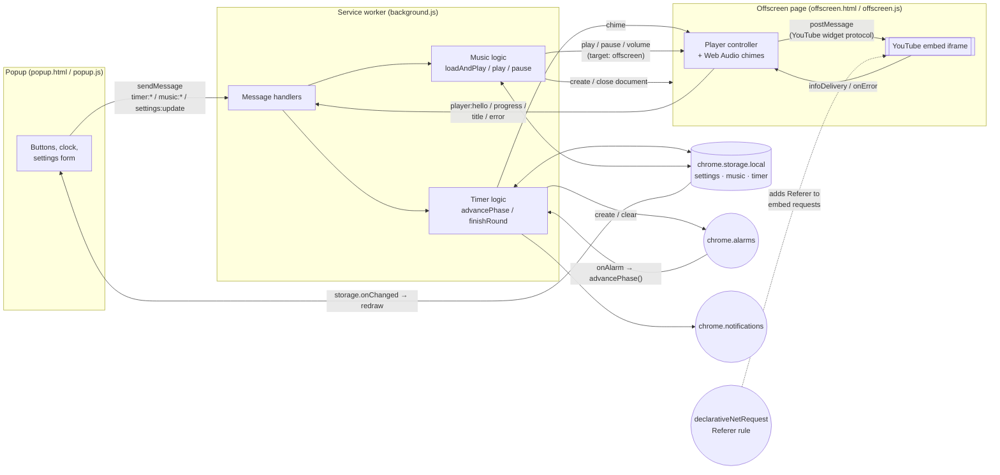
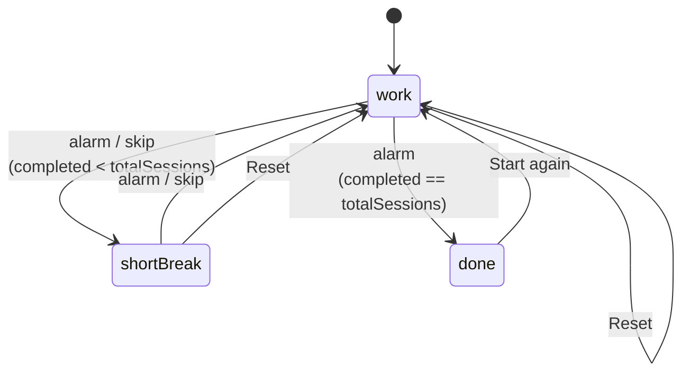

# Focus Tunes: YouTube Music + Pomodoro

A Chrome extension that plays any YouTube video as background music while you
work through Pomodoro focus and break sessions, all from one popup.

## Load it in Chrome

1. Download and unzip `youtube-pomodoro.zip` (or use this folder as is).
2. Open `chrome://extensions` in Chrome.
3. Turn on **Developer mode** (top-right switch).
4. Click **Load unpacked** and pick the `youtube-pomodoro` folder (the one with
   `manifest.json` in it).
5. Click the puzzle-piece icon in the toolbar and pin **Focus Tunes**.

After you edit any file, click the circular reload arrow on the extension's
card in `chrome://extensions`, then reopen the popup.

## Using it

- **Music:** paste a YouTube link, click **Load**. It starts playing and loops.
  Close the popup and it keeps playing. Use Play/Pause and the volume slider.
- **Timer:** click **Start**. Focus sessions (25 min) alternate with breaks
  (5 min). After the last focus session (4 by default) the timer stops and you
  get a "Good work, you're done!" notification. **Start again** begins a new
  round. You get a notification at each switch. Change lengths under **Settings**.
- **Pause music during breaks** (on by default): music stops when a break
  starts and comes back when focus starts again.
- **Chime when a session ends** (on by default): two soft notes play at each
  switch. They go down going into a break and up going back to focus. A
  longer rising chime plays when the whole round is done.

## How the code is organised

| File | What it does |
| --- | --- |
| `manifest.json` | Tells Chrome what the extension is and which permissions it needs. |
| `background.js` | The brain. Runs the timer with `chrome.alarms`, stores all state in `chrome.storage`, and opens the hidden player page. |
| `offscreen.html` / `offscreen.js` | A hidden page that holds the official YouTube embedded player, so music survives the popup closing. Controlled with `postMessage`. |
| `popup.html` / `popup.css` / `popup.js` | The popup you see. It reads state from storage and sends button clicks to the background. |
| `icons/` | Toolbar and notification icons. |

## How it works

The extension is built from three separate pages that never share memory. They
coordinate through **messages** and a single source of truth in
**`chrome.storage.local`**.



### Who does what

- **Popup (`popup.js`) is a stateless view.** On open, and every time
  storage changes, it reads `settings`, `music` and `timer` and redraws. A
  250 ms interval updates the clock locally from `timer.endTime`, so the
  service worker doesn't have to tick. Every button just sends a message such as
  `{ type: "timer:start" }`; it never changes state itself.
- **Service worker (`background.js`) owns all state and logic.** Chrome can
  stop the worker at any time, so it keeps nothing important in memory: every
  handler loads state from storage, changes it, and writes it back
  (`getState` / `updateState`). The `handlers` object in the
  `onMessage` listener works like a small API router.
- **Offscreen page (`offscreen.js`) is the speaker.** Popups are destroyed
  when closed, so audio lives in a hidden offscreen document instead. It cannot
  use `chrome.storage`, so when it starts it asks the worker for what to play
  (`player:hello`), builds the YouTube iframe, and reports back progress, title
  and errors. Chimes are made with the Web Audio API in the same page.

### Message types

| Direction | Types |
| --- | --- |
| Popup → worker | `music:load`, `music:play`, `music:pause`, `music:volume`, `timer:start`, `timer:pause`, `timer:reset`, `timer:skip`, `settings:update` |
| Worker → offscreen (`target: "offscreen"`) | `play`, `pause`, `volume`, `chime` |
| Offscreen → worker | `player:hello`, `player:progress`, `player:title`, `player:error` |
| Offscreen ↔ YouTube iframe | `window.postMessage` JSON (`listening`, `command`, `infoDelivery`, `onError`) |

### Example: loading a song

```mermaid
sequenceDiagram
    actor User
    participant Popup as popup.js
    participant BG as background.js
    participant Store as chrome.storage
    participant Off as offscreen.js
    participant YT as YouTube iframe

    User->>Popup: Paste link, click Load
    Popup->>BG: music:load { url }
    BG->>BG: parseVideoId(url)
    BG->>Store: music = { videoId, playing: true, ... }
    Store-->>Popup: onChanged → redraw ("Loading…")
    BG->>BG: installRefererRule()
    BG->>Off: offscreen.createDocument()
    Off->>BG: player:hello
    BG-->>Off: { music, volume, chime }
    Off->>YT: create iframe /embed/{id}?enablejsapi=1&loop=1
    Off->>YT: postMessage "listening" (every 500 ms until reply)
    YT-->>Off: infoDelivery { videoData.title, currentTime }
    Off->>BG: player:title / player:progress (every 3 s)
    BG->>Store: music.title, music.currentTime
    Store-->>Popup: onChanged → shows title
```

### Timer state machine

The timer is never a running countdown. It stores an `endTime` and sets a
single `chrome.alarms` alarm for that moment. When the alarm fires (even if the
worker was asleep) Chrome wakes the worker, which calls `advancePhase()`.



On each transition the worker:

1. Updates `timer` in storage and schedules the next alarm (if running).
2. Pauses music going into a break (marking `pausedByTimer`) and resumes it
   going back to work, when **Pause music during breaks** is on.
3. Shows a notification and sends a `chime` to the offscreen page (opening it
   first if needed; the chime is held in `pendingChime` until `player:hello`).

Pausing stores `remainingMs` and clears the alarm; starting again sets a new
`endTime` from it.

### Surviving restarts

- **Worker stopped:** no effect, since state is in storage and alarms wake it.
- **Offscreen page closed by Chrome** (after ~30 s of silence): `currentTime`
  was saved every 3 s, so the next `play` recreates the page and resumes from
  that spot.
- **Browser restart:** `onStartup` marks music stopped and resets the timer,
  because any saved `endTime` would be stale.

## Known limitations

- **Some videos won't play.** Many official label music videos block
  embedding (the popup shows a message when that happens). Try a lyric video
  or another upload of the same song.
- **Error 153 workaround.** YouTube's embedded player needs a Referer header
  that extension pages don't send. `background.js` adds one (see
  `installRefererRule`), only for requests made by this extension's hidden
  page. If YouTube changes how embeds work, this is the part likely to need a fix.
- **Long pauses.** Chrome closes the hidden player after about 30 seconds of
  silence. The extension saves your spot, so Play resumes where you left off.
- **Ads** can play, as in any embedded YouTube player.

## Debugging

- Background: `chrome://extensions` → Focus Tunes → **service worker** link opens DevTools.
- Hidden player: `chrome://extensions` → Focus Tunes → **offscreen.html** link (shown while music is loaded).
- Popup: right-click the popup → **Inspect**.
